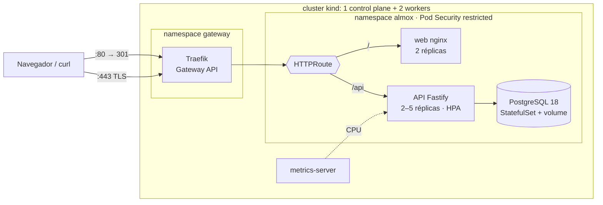

# Infra do Almoxarifado: Kubernetes, Helm e Terraform


Deploy do [almoxarifado-robotica](https://github.com/Kauan-V-Marques/almoxarifado-robotica) (React + API Fastify + PostgreSQL) num cluster Kubernetes. A **plataforma** (Gateway, TLS, métricas) e a **aplicação** (namespace, segredos, chart Helm) são provisionadas com **Terraform**.

A cada push, o GitHub Actions sobe um **cluster de verdade com 3 nós (kind)**, faz o deploy completo e testa de fora, pelo HTTPS, como um usuário. Depois provoca falhas e confere que nada cai:

- troca todas as réplicas **sob carga**, sem perder uma requisição sequer;
- mata o banco e confere que os dados continuam lá;
- tenta acessar o que não devia.

## Arquitetura



| Camada | Quem cria | O que tem |
|---|---|---|
| Cluster | `scripts/criar-cluster.sh` | kind 3 nós (Kubernetes 1.34) + CRDs da Gateway API |
| Plataforma | Terraform, [`modules/plataforma`](terraform/modules/plataforma) | Traefik como Gateway (HTTP + HTTPS), certificado TLS, metrics-server |
| Aplicação | Terraform, [`modules/almoxarifado`](terraform/modules/almoxarifado) | Namespace restrito, senhas geradas, Secret e o release do chart |
| Manifests | Chart [`charts/almoxarifado`](charts/almoxarifado) | Deployments, StatefulSet, Services, HTTPRoutes, HPA, PDBs, NetworkPolicies, `helm test` |

## O que a CI prova

**Validação (sem cluster):**

| Etapa | O que confere |
|---|---|
| `helm lint` + **kubeconform** | Manifests válidos contra o schema do Kubernetes 1.34, inclusive o HTTPRoute |
| Casos recusados | O chart rejeita imagem sem tag, tag `latest`, deploy sem Secret, chave desconhecida nos values (`values.schema.json`)... |
| `terraform test` | 10 testes com providers simulados: validação de variáveis, NodePort no kind × LoadBalancer em produção, Gateway fechado para namespaces sem permissão, senhas fora dos values do Helm |
| **Trivy** | Configuração insegura nos manifests e no Terraform. A CI para em HIGH/CRITICAL |

**Deploy no kind:**

| Etapa | O que confere |
|---|---|
| `terraform apply` | Sobe a plataforma e a aplicação do zero e espera tudo ficar pronto |
| `helm test` | De dentro do cluster: API e front respondem, e um pod que não é a API **não consegue** abrir o banco |
| Teste de fumaça | Redirect HTTP→HTTPS, SPA, cabeçalhos de segurança, login, cookie `HttpOnly; Secure; SameSite=Strict`, refresh, cadastro |
| **Rollout sob carga** | Reinicia todos os pods da API e do front com requisições sem parar: **zero falhas** |
| **Banco reiniciando** | Apaga o pod do PostgreSQL: o StatefulSet recria, o dado continua no volume e **nenhum pod da API reinicia** |
| Isolamento de rede | Pod em outro namespace tenta a API e o banco direto: bloqueado |
| Autoscaling | O HPA lê a CPU da API pelo metrics-server |
| Sem drift | `terraform plan` logo depois do apply não tem nada a mudar |
| `terraform destroy` | O ciclo completo funciona |

## Decisões

| Decisão | Por quê |
|---|---|
| **Gateway API** (HTTPRoute) em vez de Ingress | É o padrão atual do Kubernetes. O Gateway pertence à plataforma e as rotas, a cada aplicação. Só namespaces com o label de acesso podem usar o Gateway |
| Front e API no **mesmo endereço** (`/` e `/api`) | O cookie de refresh continua same-site e não precisa de CORS no navegador |
| Segredos gerados pelo **Terraform** num Secret | As senhas nunca passam pelo Git nem pelos values do Helm (que ficam visíveis no release). Um teste garante isso |
| Pod Security **restricted** nos namespaces | Sem root, sem escalada de privilégio, `drop: ALL`, seccomp e sistema de arquivos **somente leitura** (o nginx e o PostgreSQL só escrevem em volumes `emptyDir`) |
| **NetworkPolicy** "nega tudo" + exceções | Só o Gateway chega no front e na API, e só a API chega no banco |
| `maxUnavailable: 0`, `preStop` e PDB | Rollout troca uma réplica por vez. O pod sai da rotação antes de receber o SIGTERM, e um dreno de nó nunca derruba todas as réplicas |
| `startupProbe` separado do `livenessProbe` | As migrations rodam na subida da API sem o Kubernetes achar que ela travou |
| HPA no lugar de `replicas` fixas | Se o Deployment fixasse réplicas, cada deploy desfaria a escala. O chart omite o campo quando o HPA está ligado (e a CI confere) |
| Ferramentas com **SHA-256 conferido** | [`instalar-ferramentas.sh`](scripts/instalar-ferramentas.sh) baixa versões fixas e confere o checksum publicado. Nada de `curl \| sh` nem actions de terceiros com tag móvel |
| Imagens com **tag imutável** | A tag é o commit da aplicação. `latest` é recusado pelo chart e pelo Terraform |

### Mudanças na aplicação que o Kubernetes exigiu

O deploy com várias réplicas mostrou três problemas no [almoxarifado-robotica](https://github.com/Kauan-V-Marques/almoxarifado-robotica), corrigidos lá com testes:

1. **Migrations concorrentes:** duas réplicas subindo juntas tentavam criar as mesmas tabelas. Agora a preparação do banco roda sob um *advisory lock* do PostgreSQL.
2. **Limite de login atrás do proxy:** todo mundo aparecia com o IP do Gateway. Com `TRUST_PROXY`, o limite vale por cliente (`X-Forwarded-For`).
3. **Queda do banco derrubava a API:** uma conexão ociosa que caía emitia `error` sem tratador, e o Node encerrava o processo. O teste de "banco reiniciando" daqui é o que garante que isso não volta.

## Como rodar localmente

Precisa de Docker, [kind](https://kind.sigs.k8s.io), kubectl, Helm e Terraform. Clone este repositório ao lado do `almoxarifado-robotica`:

```bash
make cluster     # kind com 3 nós + CRDs da Gateway API
make imagens     # build das imagens a partir de ../almoxarifado-robotica e kind load
make deploy      # terraform apply
make teste       # helm test + teste de fumaça
```

Depois abra https://almox.localhost (o certificado é autoassinado) e entre com `capitao@almox.dev` / `robotica123`.

```bash
make validar     # só a validação, sem cluster
make destruir    # apaga o cluster
```

Para outro ambiente, só os valores mudam ([`producao.tfvars.example`](terraform/producao.tfvars.example)): imagens no registry, LoadBalancer em vez de NodePort, certificado do cert-manager e mais réplicas.

## Estrutura

```text
charts/almoxarifado/      chart Helm (templates, values.schema.json, helm test)
terraform/
  main.tf                 junta os módulos
  modules/plataforma/     Traefik (Gateway API), TLS, metrics-server
  modules/almoxarifado/   namespace, segredos e release do chart
  tests/                  terraform test (providers simulados)
  kind.tfvars             ambiente local / CI
kind/cluster.yaml         cluster de 3 nós com as portas 80/443 mapeadas
scripts/                  ferramentas, cluster, imagens, validação e teste de fumaça
```

---

<details>
<summary>English</summary>

### Almoxarifado infrastructure: Kubernetes, Helm and Terraform

Deploys the [almoxarifado-robotica](https://github.com/Kauan-V-Marques/almoxarifado-robotica) app (React, Fastify API, PostgreSQL) to Kubernetes. Terraform provisions the platform layer (Traefik as a **Gateway API** implementation, TLS, metrics-server) and the application layer (restricted namespace, generated secrets, Helm release).

On every push, CI validates the chart (lint, kubeconform, negative cases via `values.schema.json`), runs `terraform test` with mocked providers and scans everything with Trivy. It then spins up a real 3-node **kind** cluster, applies the Terraform and tests from outside over HTTPS. The smoke test runs a **rolling restart under load with zero failed requests**, deletes the database pod and checks that the data persists and no API pod restarts, and confirms that NetworkPolicies block cross-namespace access. It also checks that the HPA reads metrics, that a plan after apply shows no drift, and that `terraform destroy` succeeds.

Hardening: Pod Security "restricted", read-only root filesystems, NetworkPolicies, PDBs, `preStop` hooks, startup probes, immutable image tags, and checksum-verified tool downloads. Running with multiple replicas surfaced three bugs in the app (concurrent migrations, rate limiting behind a proxy, and the process crashing when the database dropped connections). All three were fixed upstream with tests.

</details>
